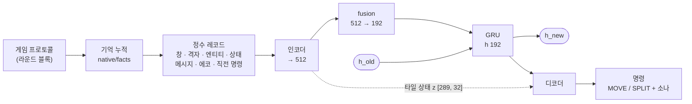
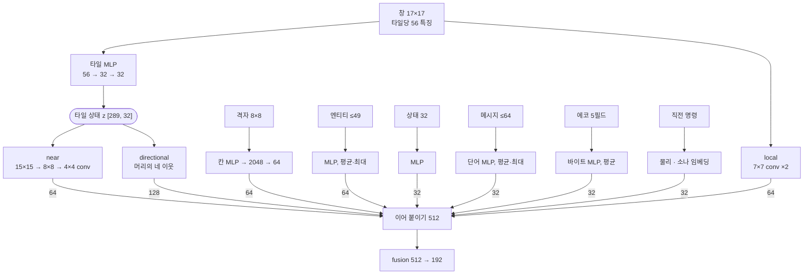
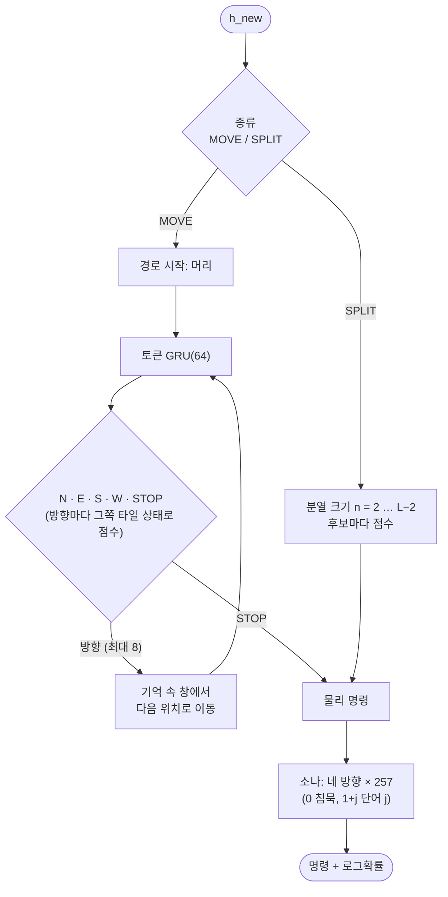
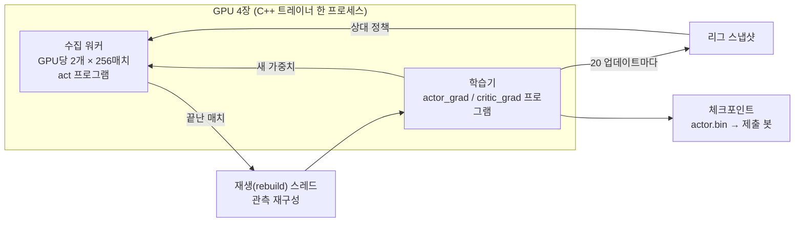

# simple1 모델 설명

용(dragon) 한 마리가 자기 차례에 내리는 결정 하나를 정책(actor)이 출력하고, 학습 중에만 쓰는 비평가(critic)가 경기 결과를 예측한다.

- **정책(actor):** 675,798 파라미터. 제출용 봇에서도 그대로 실행된다.
- **비평가(critic):** 325,217 파라미터. 학습 때만 쓰고, 정책이 볼 수 없는 실제 보드 전체를 본다.

## 전체 구조

---

## 1. 결정 하나의 입력

게임 프로토콜로 받은 관측을 C++ 코드(`native/facts`, `native/observation`)가 "이 용이 지금까지 기억하는 사실"로 누적하고, 그것을 고정 크기의 정수 레코드로 인코딩한다. 용마다 기억은 따로다. 분열로 새로 생긴 용은 빈 기억에서 시작한다.

| 입력 | 크기 | 내용 |
|---|---|---|
| 창(window) | 17×17 타일 × 16 필드 | 머리를 중심으로 한 기억 속 지도: 마지막으로 본 라운드, 진주, 침대 카운트다운, 방문 기록, 자기 몸 위치, 점유자(자기/아군/적의 머리·몸), 네 방향 가장자리 종류(빈칸/해초/포털), 포털 목적지 |
| 격자(grid) | 8×8 칸 × 14 필드 | 맵 전체를 머리 기준 8×8 칸으로 나눈 요약: 칸별 타일 수, 본/보이는/방문한 비율, 진주·침대·아군·적 수, 해초·포털 수, 평균 경과 시간 |
| 엔티티 | 최대 49개 | 시야 안의 용들: 관계(자기/아군/적), 차례 순서, 길이, 머리 위치·방향, 몸 조각들의 상대 위치 |
| 상태 | 32개 값 | 길이, 라운드, 맵 크기, 유닛 수/한도, 방향, 머리 좌표, 직전 명령 정보, 받은 메시지 수, 에코 여부 등 |
| 받은 메시지(inbox) | 최근 64개 × 8바이트 | 소나로 받은 64비트 단어들 |
| 에코 | 5필드 × 최대 32바이트 | 소나 에코 |
| 직전 명령 | | 이동 방향들/분열 크기, 방향별로 보낸 소나 단어 |

창의 각 타일은 56개의 특징(feature) 값으로 변환된다. 이 값은 경과 시간, 로그 스케일 카운트, 원-핫, 머리 기준 상대 위치(sin/cos) 같은 것들이다(`features.actor_inputs`).

## 2. 인코더: 결정 하나 → 벡터 512

| 모듈 | 구조 | 출력 |
|---|---|---|
| 타일 MLP | 56 → 32 → 32 (둘째 층은 fp16), 289 타일 각각 | 타일 상태 z [289, 32] |
| local | 7×7 창의 원시 특징에 3×3 합성곱 2개 (56→32→32, fp16) → 중앙·평균·최대 → 96 → 64 | 64 |
| near | 타일 상태 z의 중앙 15×15에 stride 2 합성곱 2개 (15→8→4) → 512 → 64 | 64 |
| grid | 칸마다 (15 특징 + 위치 임베딩 8) → MLP 32 → 64칸 이어붙임 2048 → 64 | 64 |
| entities | 엔티티마다 20 → 32 → 32, 마스크 평균·최대 → 64 | 64 |
| status | 32 → 32 → 32 | 32 |
| inbox | 단어마다 (바이트 임베딩 8 + 위치 임베딩 8) × 8바이트 → MLP 64→32→32, 평균·최대 + 개수 → 32 | 32 |
| echo | 바이트마다 임베딩 → MLP 8→16→16, 필드별 평균 → 85 → 32 | 32 |
| previous | 직전 물리 명령(36) → 32, 방향별 직전 소나 단어 → 16×4, → 97 → 32 | 32 |
| directional | 머리의 네 이웃 방향마다 [그쪽 타일 상태 z(모르면 학습된 unknown 벡터), 가장자리 특징 12] → 32 | 128 |

위 출력을 모두 이어 붙이면 512가 되고, fusion 층(512 → 192)을 지난다. 활성화 함수는 모두 SiLU다.

## 3. 기억: GRU

`h_new = GRU(fusion 출력 192, h_old 192)`

용 한 마리의 생애(lifetime) 동안 은닉 상태 h가 이어진다. 학습 때는 16결정 단위(chunk) 경계에서 저장한 h로 다시 시작한다.

## 4. 디코더: 명령 만들기

명령은 **종류 → 물리 명령 → 소나** 순서로 뽑는다. 각 단계는 앞 단계에 조건부이고, 명령 전체의 로그확률은 각 단계 로그확률의 합이다.

1. **종류:** MOVE 또는 SPLIT (192 → 2). SPLIT은 길이 4 이상이고 유닛 한도가 남았을 때만 허용된다.
2. **SPLIT 크기:** 후보 n = 2 … L−2 (최대 512개). 후보마다 [h, 크기 특징 6] → 64 → 1 점수를 매긴다.
3. **MOVE 방향 토큰:** 자기회귀 방식으로 최대 8스텝.
   - 작은 GRU(64)가 직전 토큰과 현재 경로 위치를 받는다.
   - 네 방향 각각을 [r, h, 그 방향 타일 상태, 가장자리 특징, 경로 정보] → 64 → 1로 점수 매긴다.
   - STOP은 별도 점수기가 맡는다.
   - 경로는 기억 속 창 위를 실제로 따라가면서, 포털 목적지를 포함해 다음 위치를 추적한다.
4. **소나:** 네 방향 각각 257개 중 하나를 고른다(0 = 침묵, 1+j = 단어 j 전송). 입력은 [h, 물리 명령 임베딩 32, 방향].

샘플링은 결정마다 균등분포 난수 13개로 하는 역-CDF 방식이다.

## 5. 비평가(critic)

- **입력:** 실제 보드 전체를 8×8 칸으로 요약한 것(타일, 진주, 침대, 양 팀 머리·몸, 해초, 포털).
- **살아있는 모든 용:** 팀, 길이, 위치, 방향, 순위, 행동 여부에 그 용의 정책 은닉 상태 요약(h, 193)을 더해 MLP 207 → 64 → 64로 보내고, 평균·최대를 낸다.
- **전역값:** 라운드, 양 팀 최장·총 길이, 수 등 16개.
- **출력:** 이어 붙여 272 → 128 → 64 → 1, tanh. 한 팀 관점의 승패 예측값 V ∈ [−1, 1].

## 6. 학습 (PPO)

- **데이터:** 경기가 끝난 매치의 모든 결정(학습자 쪽). 한 업데이트에 약 65,536결정 이상.
- **이득(advantage):**

  > G − V_old − 0.3·[사망] + 0.3·[나에게 들이받고 죽은 적 수]

  - G는 승리 +1, 패배 −1, 무승부 0이다. 몬테카를로 방식이라 생애의 모든 결정에 같은 값이 붙는다.
  - 사망 벌점은 벽, 자기 몸, 다른 용의 몸, 둘 곳 없음으로 죽었을 때 붙는다. 머리끼리 충돌(head-to-head)은 벌점이 없다.
  - 적이 이 용의 몸을 들이받고 죽으면 한 번마다 +0.3을 받는다.
- **PPO 설정:**

  | 항목 | 값 |
  |---|---|
  | 클립 | [0.9, 1.1] |
  | 엔트로피 보너스 | 물리 0.005, 소나 0.001 |
  | 업데이트당 미니배치 | 4개 (1 epoch) |
  | KL 한도 | 0.02를 넘으면 그 업데이트의 actor 단계를 멈춘다 |
  | 그래디언트 노름 클립 | 0.5 |
  | 옵티마이저 | Adam, lr 3e-4 |

- **비평가 학습:** 결정의 10%를 골라 (V − G)² 로 학습한다.
- **상대 구성:** 50%는 자기 자신과 대전(양쪽 모두 학습에 사용), 50%는 리그 스냅샷(20 업데이트마다 저장)과 대전한다. 스냅샷은 최근 것과 오래된 것을 섞어 뽑는다.

## 7. 실행 환경

- **학습 (C++ 트레이너, `runtime/trainer_main.cpp`)**
  - JAX는 빌드 단계에서 모델을 XLA 프로그램으로 내보내는 데만 쓴다(`dragons_rl/export.py`).
  - 실행은 C++ 프로세스 하나가 PJRT로 GPU 4장에서 수집 워커(GPU당 2개, 각 256매치)와 학습기를 함께 돌린다.
  - 수집과 학습은 서로 다른 PJRT 클라이언트라서 GPU 위에서 겹쳐 실행된다.
- **제출용 봇 (`bot/`, `native/policy`)**
  - 같은 정책을 표준 라이브러리만으로 구현한 C++ 순전파다.
  - JAX와 비교해 명령이 거의 전부 일치한다(1,200결정 중 1,199개. 나머지 1개는 부동소수 경계에서 갈린 샘플).
  - 가중치(2.7 MB)는 소스에 정수 배열로 컴파일해 넣는다. 심판 샌드박스는 파일을 읽을 수 없고, 텍스트 디코딩은 CPU 예산을 넘겼기 때문이다.
  - 샌드박스(wasm)에서 턴당 CPU 포인트는 중앙값 약 23M, 최대 약 37M이다(한도 100M). 네이티브로는 결정당 약 0.6 ms.
  - 빌드: `bot/make_bot.sh <actor.bin> <폴더>` → `unswbc run` / `unswbc submit`.
